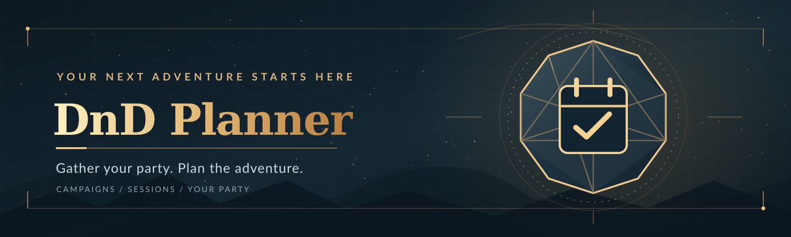

# DnD Planner

A self-hosted D&D campaign planner: DMs run campaigns with private notes and
session prep, propose the next session date, and players RSVP (or back out
with a reason the group can see). Includes a cross-campaign calendar,
recurring session scheduling, a party roster with best-effort D&D Beyond
import, and in-app notifications.

## Features

- **Sign in** with email/password or Discord.
- **Per-campaign roles** — the same account can DM one campaign and play in
  another.
- **Campaigns**: create, invite players via a shareable link or invite code
  (paste either into "Join campaign"), join/leave.
- **Sessions & RSVP**: the DM proposes a date, players respond Yes/No. Backing
  out after saying Yes asks for a quick reason, visible to the whole party.
- **Recurring sessions**: set a cadence (e.g. every other Saturday) and the
  app drafts the next date ahead of time for the DM to review and send.
- **Calendar**: a month view of every proposed/confirmed session across your
  campaigns, plus a private .ics subscription feed (Outlook/Google/Apple
  Calendar) that stays in sync as sessions change.
- **Roster**: each player's character (name/class/level/race), with an
  optional best-effort import from a public D&D Beyond sheet.
- **DM notes & session prep**: private markdown notes, visible only to the DM.
- **Notifications**: in-app bell + full history for invites, proposals,
  cancellations, and RSVP changes.
- **Account settings**: change your password (email/password accounts only).
- **Dark mode**: light/dark/system, toggle in the nav.
- **Admin panel**: the first person to ever sign in becomes admin
  automatically — no setup step or env var needed. Admins can set the
  server's public URL (so invite/calendar links don't show `localhost`
  behind a reverse proxy or tunnel), create accounts, promote/demote other
  admins, disable/re-enable accounts, and reset a forgotten password for
  any email/password account — all without needing an email server.

## Stack

Next.js (App Router, TypeScript) + Tailwind, Prisma + PostgreSQL, Auth.js
(NextAuth v5), Docker Compose for self-hosting.

## Running with Docker Compose (recommended)

1. Copy the example environment file and fill in `NEXTAUTH_SECRET` (any long
   random string — `openssl rand -base64 32` works) and, if you want Discord
   sign-in, `DISCORD_CLIENT_ID`/`DISCORD_CLIENT_SECRET` from a
   [Discord application](https://discord.com/developers/applications):

   ```bash
   cp .env.example .env
   ```

2. Build and start the app + database:

   ```bash
   docker compose up --build
   ```

   The app runs database migrations automatically on startup and is then
   available at [http://localhost:3000](http://localhost:3000).

## Running on TrueNAS SCALE

On SCALE 24.10 ("Electric Eel") or newer, Apps runs on a native Docker
backend, so you can deploy via **Apps → Discover Apps → Custom App →
Install via YAML** using `docker-compose.truenas.yml` instead of
`docker-compose.yml`. The difference: it pulls a prebuilt image from GHCR
rather than building `docker/Dockerfile` locally, since the Apps YAML
importer deploys images, it doesn't build them.

1. Push to `main` (or run the "Publish Docker image" workflow manually) —
   `.github/workflows/docker-publish.yml` builds and pushes the image to
   `ghcr.io/nevelish/dnd-planner` automatically. If the package ends up
   private (the default for a private repo), either make it public from the
   package's GitHub settings, or `docker login ghcr.io` on the TrueNAS host
   with a PAT that has `read:packages`.
2. Create a dataset for Postgres's data, e.g. `tank/apps/dnd-planner/pgdata`,
   so it's visible to TrueNAS's own snapshot/backup tooling instead of
   living in a Docker-managed volume.
3. Copy `docker-compose.truenas.yml`, fill in every `REPLACE_ME` (secrets,
   the dataset path, and `NEXTAUTH_URL` — your public domain, e.g. a
   Cloudflare Tunnel hostname), and paste it into the Custom App YAML editor.
4. Point your reverse proxy / tunnel at the TrueNAS host's IP on the port
   you mapped (`3000` by default).
5. Sign in once — since no admin exists yet, you become the admin
   automatically — then set the same public address in `/admin/settings` →
   Public URL, so invite and calendar links use it instead of `localhost`.

## Local development (without Docker for the app)

1. Start a local Postgres with Docker:

   ```bash
   cp .env.example .env
   docker compose -f docker-compose.dev.yml up -d
   ```

2. Install dependencies and apply migrations:

   ```bash
   npm install
   npx prisma migrate dev
   ```

3. (Optional) seed some demo data — a campaign with a DM and two players:

   ```bash
   npx prisma db seed
   ```

   This creates `dm@example.com` / `player1@example.com` / `player2@example.com`,
   all with password `password123`.

4. Run the dev server:

   ```bash
   npm run dev
   ```

## Environment variables

See `.env.example`. `DATABASE_URL`, `NEXTAUTH_SECRET`, and `NEXTAUTH_URL` are
required. `DISCORD_CLIENT_ID`/`DISCORD_CLIENT_SECRET` are optional — leave
them blank to ship with email/password only; the "Continue with Discord"
button is hidden until both are set.

## Notes on the D&D Beyond integration

D&D Beyond has no official public API. Linking a character fetches from the
same undocumented endpoint public character sheets use in the browser
(`character-service.dndbeyond.com`). This only works for **public** sheets,
is explicitly best-effort, and can break if D&D Beyond changes that service.
Manual character fields always remain editable regardless of sync status.
